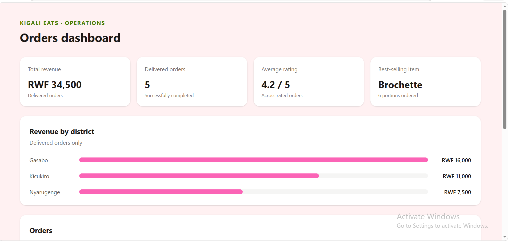

# Week 5: Array & Object Drills

Solutions for the Week 5 array and object manipulation workshop, using the Kigali Eats orders dataset.

## Dashboard



## Project files

- `data.js` — Kigali Eats orders dataset
- `drills.js` — numbered solutions for Stations 1–4
- `kigali-eats-dashboard/` — Vite and Tailwind dashboard for Station 5

## Run the dashboard

```bash
cd kigali-eats-dashboard
npm install
npm run dev